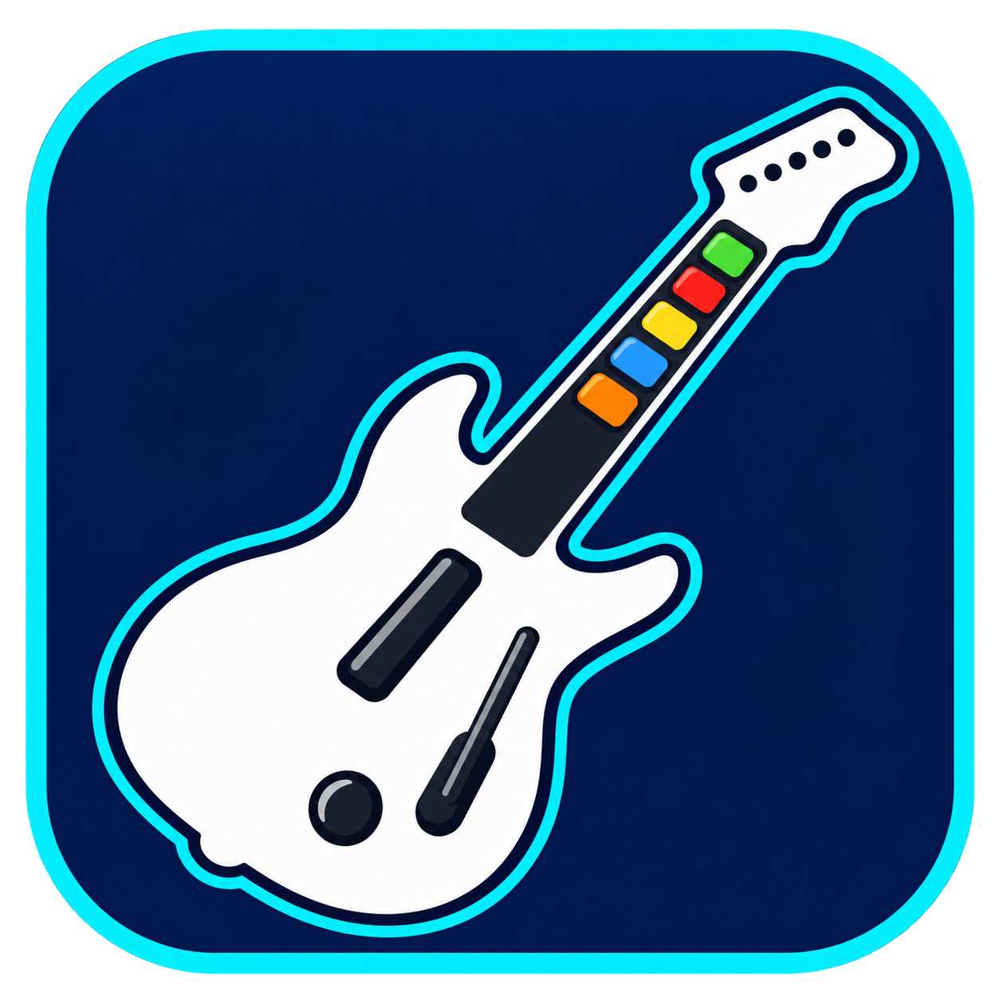
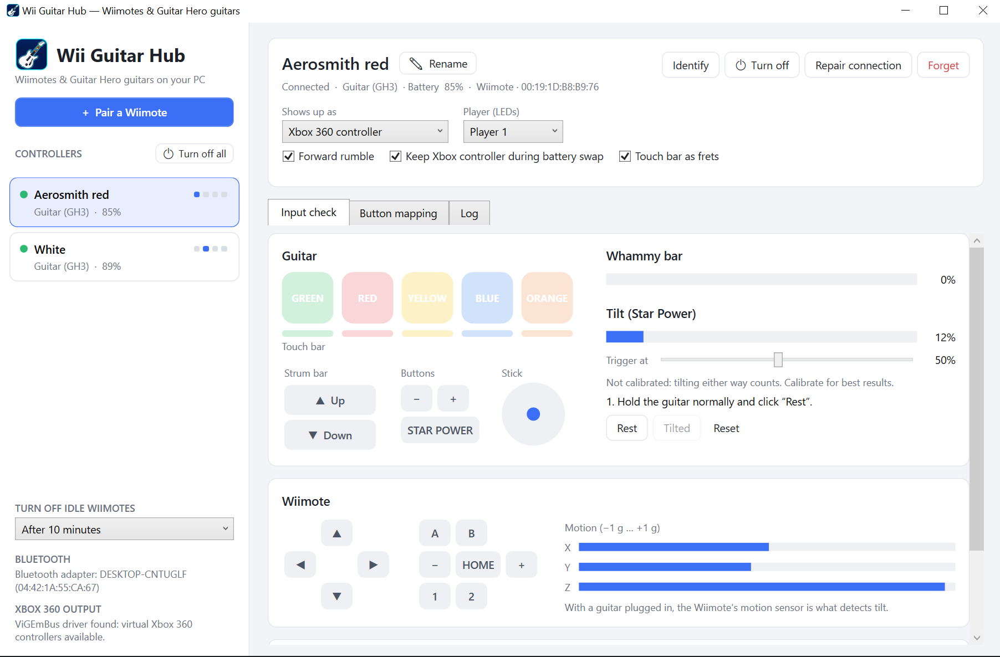
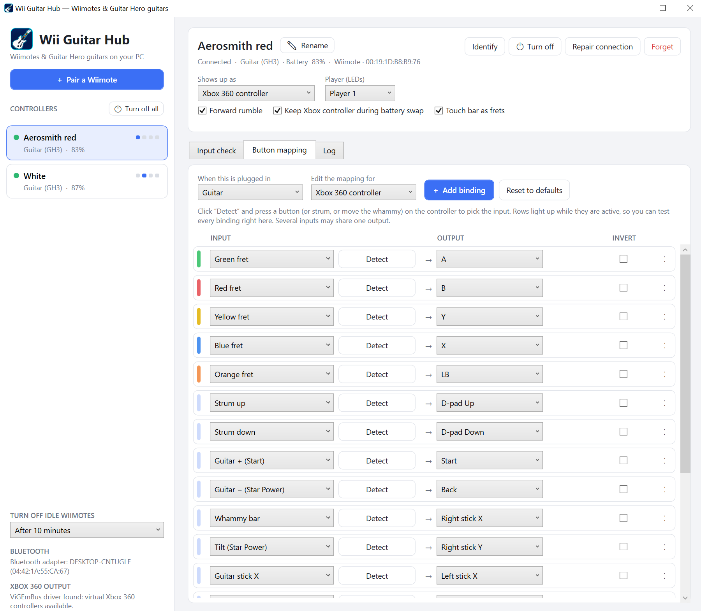

<p align="center"></p>

# Wii Guitar Hub

Play PC games with your **Wii Remotes** and **Wii Guitar Hero guitars**, wirelessly over Bluetooth.



Wii Guitar Hub connects your Wiimotes to Windows and makes each one show up as an **Xbox 360 controller** or as
**keyboard keys**. Plug a Guitar Hero guitar into the Wiimote and it works in games such as
**Clone Hero** and **YARG**. That covers frets, strumming, whammy and Star Power tilt.

- Pair once with the red SYNC button. After that, **press any button and it reconnects**, also after
  changing batteries.
- **Several controllers at once**, each with its own player number (shown on the Wiimote's LEDs).
- **Live input check**: press green and you see green light up.
- **Button remapping** for every button, fret, whammy and stick.
- **Name your controllers**, e.g. "Red guitar" or "Aerosmith".
- **Turn Wiimotes off** from the PC, or let idle ones switch off automatically to save batteries.
- **Low-battery warning**: a Windows notification and a short rumble on the guitar.
- **Runs in the tray**, can **start with Windows**: ideal for a dedicated Clone Hero / YARG PC.
- **Light and dark theme**, or follow Windows.

---

## What you need

- A Windows 10 or Windows 11 PC with **Bluetooth**: built-in, or a USB Bluetooth adapter.
- An **original Nintendo Wii Remote**, either the normal one or the "Motion Plus inside" one.
  Most third-party Wiimotes do not work on a PC.
- Optional: a **Wii Guitar Hero guitar** (Guitar Hero III, World Tour, 5, Warriors of Rock, or a
  compatible third-party guitar) or a **Nunchuk**.

## Installation

### 1. Install ViGEmBus (for Xbox controller mode)

Wii Guitar Hub uses the free **ViGEmBus** driver to create virtual Xbox 360 controllers.

1. Download `ViGEmBus_…_x64_x86_arm64.exe` from the
   [ViGEmBus releases page](https://github.com/nefarius/ViGEmBus/releases).
2. Run it and click through the installer.
3. Restart your PC if it asks you to.

You can skip this if you only want **keyboard** output. Wii Guitar Hub works without the driver and shows a
notice in the sidebar.

### 2. Download Wii Guitar Hub

1. Go to the [Releases page](https://github.com/Spaggel/WiiGuitarHub/releases) and download
   `WiiGuitarHub-win-x64.zip` from the newest release.
2. Extract the zip to a folder of your choice, for example `Documents\Wii Guitar Hub`.
3. Double-click **WiiHub.exe**.

You don't need to install anything else; .NET is included.

> **Windows protected your PC?** Wii Guitar Hub is not code-signed, so Windows SmartScreen may warn you the
> first time. Click **More info → Run anyway**.

---

## Connecting a Wiimote

You only have to do this **once per Wiimote**.

1. In Wii Guitar Hub, click **+ Pair a Wiimote**.
2. Keep **Permanent — red SYNC button** selected.
3. Open the battery cover of the Wiimote and press the small **red SYNC button**. The blue LEDs
   start blinking.
4. Click **Search & pair** within about 20 seconds.
5. When it says *paired*, close the window. After a few seconds the Wiimote:
   - appears in the list on the left,
   - rumbles once,
   - lights up its player LED.

You can pair several Wiimotes one after another, or press SYNC on more than one at the same time.

**Why the SYNC button?** When paired with SYNC, the Wiimote remembers your PC. Pairing with the
1 + 2 buttons also works, but then you have to pair again every time the Wiimote turns off.

### Already paired it before?

A Wiimote paired through Windows Settings, with 1 + 2, or that was synced to a Wii again, will not
reconnect by itself. Fix it like this:

1. Open **+ Pair a Wiimote**.
2. Under *Wiimotes Windows already knows*, click **Remove** next to it.
3. Pair it again with the red SYNC button.

---

## Everyday use

| You want to… | Do this |
|---|---|
| Turn a Wiimote on | Press **any button**. It reconnects to Wii Guitar Hub by itself. |
| Change batteries | Just swap them and press a button. It comes back as the same player with the same settings. |
| See which Wiimote is which | Select it and click **Identify**. That Wiimote rumbles. |
| Name a Wiimote | Click **✎ Rename** in the header, press **F2**, or double-click it in the list. |
| Change the player number | Use the **Player (LEDs)** dropdown. |
| Turn one Wiimote off | Click **Turn off** in the header, or right-click it in the list → **Turn off**. |
| Turn all Wiimotes off | Click **Turn off all** in the sidebar, or right-click the tray icon → **Turn off all Wiimotes**. |
| Check the batteries | Each controller shows a battery icon and percentage in the list. |
| Check the connection | Signal bars next to each controller show the connection quality. Hover them for details. |
| Change settings | Click **Settings** at the bottom of the sidebar. |

Turning a Wiimote off keeps it paired. Press any button to turn it on again.

### Connection quality and range test

Each connected controller shows **signal bars** (in the list and the header) and a rating:
**Good**, **Fair** or **Poor**. Windows doesn't tell apps the real Bluetooth signal strength of a
Wiimote, so Wii Guitar Hub measures what matters for playing instead:

- **Updates per second**: a Wiimote sends about 100 updates per second.
- **Dropouts**: moments where nothing arrives for 60 ms or longer. These cause missed notes or
  "stuck" frets.
- **Response time**: every few seconds Wii Guitar Hub asks the Wiimote for one byte and times the
  answer.

To check a spot before you play, open the **Input check** tab and use **Run range test** in the
**Connection** card. Stand or sit where you normally play, hold the guitar as you would while
playing, and wait 20 seconds. You get a verdict with the numbers and, if needed, tips. The most
common fix is moving a USB Bluetooth adapter from the back of the PC to the desk with a short USB
extension cable.

A busy PC or a weak Bluetooth adapter also shows up as a worse rating. That's intended: it affects
your game just the same.

### Settings

Click **Settings** at the bottom of the sidebar. Changes are saved immediately.

| Setting | What it does |
|---|---|
| **Theme** | Light, Dark, or **Follow Windows** (default). |
| **Turn off idle Wiimotes** | Switch off a Wiimote nobody touched for 5, 10 (default), 15 or 30 minutes or 1 hour, or never. |
| **Low battery** | When a Wiimote drops to 15% or below: show a Windows notification and/or rumble the Wiimote (three short pulses). Both on by default, each can be turned off. A Wiimote warns once, and again only after new batteries ran low. |
| **Minimize to the tray** | Minimizing hides the window to the notification area (tray). On by default. |
| **Close button keeps it running in the tray** | The ✕ button hides the window instead of exiting. Off by default. |
| **Start with Windows** / **Start minimized** | Start automatically when you log in, optionally hidden in the tray. |
| **Check for updates** | Look for a newer release on GitHub at startup. You can also click **Check now**. |

**Notifications during games:** low-battery and update notifications are normal Windows notifications.
While a fullscreen game runs, Windows' *Do not disturb* usually holds them back until you leave the
game (you find them in the notification centre). The rumble always comes through, so leave that on
if you want to notice low batteries mid-song.

### The tray icon

While Wii Guitar Hub runs, its icon sits in the notification area next to the clock (it may be
under the **^** arrow).

- **Click** it to open the window.
- **Right-click** it to see each controller's player number and battery, **Turn off all Wiimotes**,
  or **Exit**.

Your controllers keep working while the window is hidden.

### Dedicated Clone Hero / YARG PC

For a PC that's only used for playing:

1. In **Settings**, tick **Start with Windows** and **Start minimized**, and keep **Minimize to the tray**
   on.
2. Optionally, set **Turn off idle Wiimotes** so the guitars switch off when nobody plays.

After logging in, Wii Guitar Hub starts by itself, straight into the tray. Pick up a guitar, press a
button, and it connects.
Starting Wii Guitar Hub again while it's already running just brings the open window to the front.
You can also switch the automatic start off in Task Manager → **Startup apps**.

Wii Guitar Hub must be running for the controllers to work. Leave it open, or minimise it to the tray
while you play.

---

## Guitar Hero guitars

1. Connect the Wiimote (see above).
2. Plug the Wiimote's cable into the guitar and put the Wiimote in the guitar's slot.
3. Wii Guitar Hub detects the guitar automatically. The **Input check** tab now shows the frets, strum bar,
   whammy and tilt.

Press each fret, strum up and down and push the whammy. Everything you press lights up, so you can
check the guitar works before you start playing.

### Calibrate tilt (Star Power)

Tilt is measured by the Wiimote inside the guitar. Calibrate it once per guitar:

1. Hold the guitar normally and click **Rest**.
2. Tilt the neck up, as you would for Star Power, and click **Tilted**.
3. Tilt the guitar to test. The **STAR POWER** indicator lights up.

Use the **Trigger at** slider if tilt activates too early or too late.

### Touch bar (World Tour guitars)

The slider bar on World Tour, GH5 and Warriors of Rock guitars works as extra frets. You can switch
it off with **Touch bar as frets** if it causes accidental notes.

### Default guitar buttons

| Guitar | Xbox 360 mode | Keyboard mode |
|---|---|---|
| Green / Red / Yellow / Blue / Orange | A / B / Y / X / LB | 1 / 2 / 3 / 4 / 5 |
| Strum up / down | D-pad up / down | Up / Down arrow |
| + | Start | Enter |
| − (Star Power) | Back | Space |
| Tilt | Right stick Y | Space |
| Whammy | Right stick X | W |
| Stick | Left stick | I / J / K / L |
| Wiimote Home button | Guide | Esc |

The Xbox layout matches Xbox 360 Guitar Hero and Rock Band guitars.

---

## Setting up your game

Choose what each controller shows up as with **Shows up as** in the header:

- **Xbox 360 controller**: works with almost every game. Recommended.
- **Keyboard**: sends key presses. Useful for games that don't support controllers.
- **Xbox 360 + keyboard**: both at once.
- **Disabled**: the controller is connected but sends nothing.

**Clone Hero / YARG:** the guitar appears as an Xbox 360 controller. Open the game's controller or
profile settings and assign the frets, strum, whammy and Star Power once. The game remembers it.

**Keyboard mode and games running as administrator:** Windows does not let a normal program send
keys to a game that runs as administrator. In that case, start Wii Guitar Hub as administrator too, or use
Xbox 360 mode.

**Rumble:** games can rumble the Wiimote through the Xbox controller. Turn this off with
**Forward rumble**.

**Keep Xbox controller during battery swap:** keeps the virtual Xbox controller plugged in while a
Wiimote is briefly gone, so the game doesn't drop you from your player slot.

---

## Changing buttons (mapping)

Open the **Button mapping** tab.



1. With **When this is plugged in**, choose what you want to change: **Guitar**, **Wiimote only** or
   **Wiimote + Nunchuk**. Wii Guitar Hub uses the right one automatically when you plug something in.
2. With **Edit the mapping for**, choose **Xbox 360 controller** or **Keyboard**.
3. For each row:
   - **Input** is the button on your controller. Click **Detect** and press the button to pick it.
   - **Output** is what the PC receives. In keyboard mode, click **Press key** and press the key you
     want.
   - **Invert** reverses a direction, for example flipping a stick axis.
4. **+ Add binding** adds a row. **✕** removes one. **Reset to defaults** restores the original
   layout.

Rows light up while you press their input, in the fret's colour for frets. You can test everything
right there. Changes take effect immediately and are saved automatically.

### Default Wiimote buttons (no guitar)

The Wiimote is held **sideways**, with the D-pad on the left, like an NES controller:

| Wiimote | Xbox 360 mode | Keyboard mode |
|---|---|---|
| D-pad | D-pad | Arrow keys |
| 2 / 1 | A / B | X / Z |
| A / B | Y / X | A / S |
| + / − / Home | Start / Back / Guide | Enter / Backspace / Esc |

With a **Nunchuk**, the Wiimote is held upright. The Nunchuk stick is the left stick (WASD on the
keyboard), Z is the left trigger and C is LB.

---

## Troubleshooting

**"Search & pair" finds nothing**
- Press the red SYNC button again **right before** clicking *Search & pair*. The Wiimote is only
  findable for about 20 seconds.
- Make sure Bluetooth is turned on in Windows. Wii Guitar Hub shows your adapter at the bottom of the sidebar.
- Third-party Wiimotes usually don't work on a PC.

**It's paired, but never connects**
- Select it and click **Repair connection**.
- If that doesn't help, remove it in the pairing window and pair again with SYNC.

**The Wiimote doesn't reconnect after changing batteries**
- It was probably paired with 1 + 2 instead of SYNC. Remove it in the pairing window and pair again
  with the red SYNC button.
- Wiimotes never connect on their own while idle. You have to press a button.

**"Turn off" says access denied**
- Windows sometimes only allows disconnecting a Bluetooth device for administrators. Right-click
  WiiHub.exe → **Run as administrator**.

**The guitar isn't detected**
- Unplug and replug the guitar cable from the Wiimote.
- The status line in the header should say **Guitar**. If it says *Unknown extension*, click **Log**
  at the bottom of the sidebar.

**Tilt triggers all the time or never**
- Calibrate tilt again (Rest / Tilted) and adjust the **Trigger at** slider.

**Notes are missed or frets get "stuck"**
- Look at the signal bars, or run the **range test** from the spot where you play (see *Connection
  quality and range test*). Dropouts mean the Bluetooth connection is struggling: move closer, or
  give the Bluetooth adapter a clear line of sight.

**I don't see low-battery notifications during a game**
- Windows holds notifications back during fullscreen games (*Do not disturb*). They are in the
  notification centre afterwards. The rumble warning still works in-game.

**Xbox controller mode doesn't work**
- Install ViGEmBus (see Installation) and restart your PC.

**Something else**
- Click **Log** at the bottom of the sidebar to see what Wii Guitar Hub is doing: pairing steps,
  connects, disconnects and errors. **Copy all** puts it on the clipboard; include it when you report
  a problem.

---

## Where are my settings?

Everything is saved automatically in `%AppData%\WiiHub\config.json`: names, player numbers, mappings,
tilt calibration and all settings (except *Start with Windows*, which lives in Windows' own startup list). To start fresh, close Wii Guitar Hub and delete that file.

To move Wii Guitar Hub to another folder, just move the folder. To uninstall, delete the folder and,
optionally, the settings file above.

---

## Supported devices

| Device | Status |
|---|---|
| Wii Remote (RVL-CNT-01 and -TR) | ✔ |
| Guitar Hero guitars (GH3, World Tour, GH5, Warriors of Rock, most third-party) | ✔ |
| Nunchuk | ✔ |
| Classic Controller, drums, DJ Hero turntable | Detected, not supported yet |
| Balance Board, Wii U Pro Controller, IR pointer | Not supported |

---

## For developers

Wii Guitar Hub is a C# / .NET 10 WPF app.

```
src/WiiHub.Core         Bluetooth pairing, HID I/O, Wiimote protocol, mapping, keyboard output, settings
src/WiiHub.ViewModels   UI logic (MVVM), no WPF dependency
src/WiiHub.App          WPF user interface and ViGEmBus (Xbox 360) output
```

Build and run (Windows, .NET 10 SDK):

```powershell
dotnet run --project src/WiiHub.App
```

Make a standalone build like the release zip:

```powershell
dotnet publish src/WiiHub.App -c Release -r win-x64 --self-contained true -p:PublishSingleFile=true -p:IncludeNativeLibrariesForSelfExtract=true -o publish
```

To publish a release, zip the contents of the `publish` folder as `WiiGuitarHub-win-x64.zip` and attach
it to a new release on GitHub. The installation steps above point users to that file.

Guitar protocol details come from [WiiBrew](https://wiibrew.org/wiki/Wiimote/Extension_Controllers/Guitar_Hero_(Wii)_Guitars).
